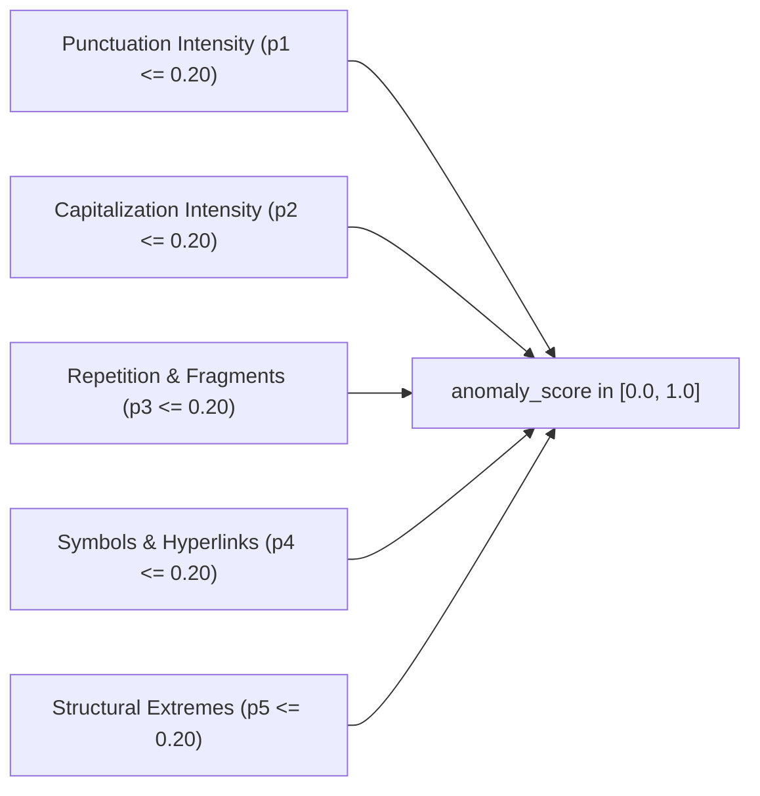
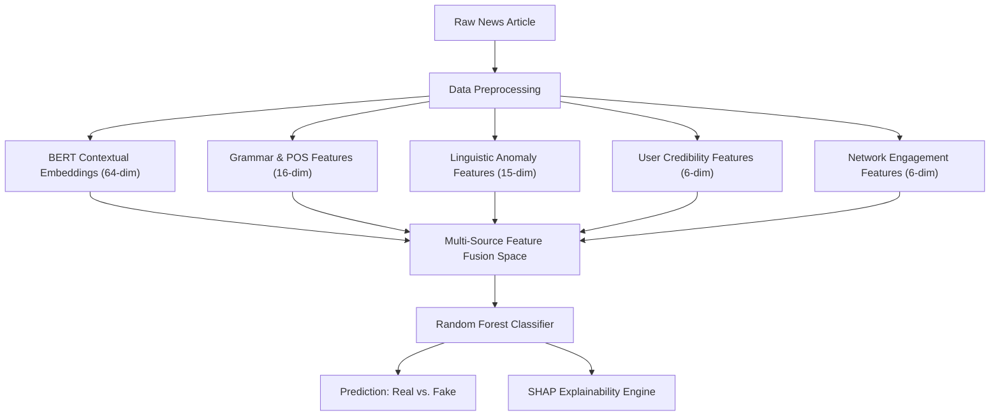

# Grammar/POS Analysis & Linguistic Anomaly Detection Module

> **Academic Project:** Hybrid Deep Learning Model for Fake News Detection Using Multi-Source Features and Explainable AI  
> **Institution:** Vels Institute of Science, Technology & Advanced Studies (VISTAS)  
> **Module Source Path:** [`src/features/`](file:///c:/Users/bhuvi/.gemini/antigravity/scratch/fake_news_detector/src/features/)

---

## 1. Module Purpose & Core Objective

The **Grammar/POS Analysis and Linguistic Anomaly Detection Module** provides rich syntactic, morphological, and structural features extracted from raw news text. It complements deep semantic representations by quantifying writing style, grammatical complexity, and unconventional formatting patterns often found in sensationalized or unverified claims.

> [!IMPORTANT]
> **Critical Architectural Note:**  
> **"Grammar and anomaly features are supporting features and are not sufficient by themselves to determine whether a news item is fake or real."**  
> They serve as one branch of a multi-source feature fusion pipeline alongside deep contextual embeddings (BERT), publisher credibility metrics, and social network diffusion signals.

---

## 2. Why Grammar & Syntactic Features Are Used

1. **Stylistic Fingerprinting:** Legitimate journalism adheres to standardized editorial standards (e.g., Associated Press stylebook), exhibiting consistent distributions of nominal phrases, past-tense reporting verbs, and subordinate attribution clauses.
2. **Sensational vs. Empirical Tone:** Fabricated or clickbait stories frequently exhibit elevated second-person pronouns (*"you"*, *"your"*), extreme modal verbs (*"must"*, *"will"*), and subjective adverbs rather than empirical noun phrases.
3. **Syntactic Complexity:** Measures like average sentence length, clause depth, and subordination ratios capture variations in syntactic sophistication.

---

## 3. Why Part-of-Speech (POS) Tagging Is Used

Part-of-Speech tagging disambiguates the grammatical function of every word in context. Rather than relying on naïve keyword counts:
- spaCy's statistical transition-based dependency parser (`en_core_web_sm`) analyzes token morphology and universal dependencies.
- It differentiates between polysemous words (e.g., *"cure"* as a `NOUN` vs. *"cure"* as a `VERB`).
- It extracts precise counts across 13 Universal Dependencies POS categories.

---

## 4. POS & Syntactic Features Extracted (16 Features)

| # | Feature Name | Description | Extraction Technique |
| :---: | :--- | :--- | :--- |
| 1 | `noun_count` | Count of common nouns | spaCy `token.pos_ == "NOUN"` |
| 2 | `pronoun_count` | Count of pronouns (*"I"*, *"they"*, *"you"*) | spaCy `token.pos_ == "PRON"` |
| 3 | `verb_count` | Count of main verbs | spaCy `token.pos_ == "VERB"` |
| 4 | `adverb_count` | Count of adverbs modifying verbs/adjectives | spaCy `token.pos_ == "ADV"` |
| 5 | `adjective_count` | Count of descriptive adjectives | spaCy `token.pos_ == "ADJ"` |
| 6 | `proper_noun_count`| Count of named entities and proper nouns | spaCy `token.pos_ == "PROPN"` |
| 7 | `conjunction_count`| Coordinating & subordinating conjunctions | spaCy `token.pos_ in ("CCONJ", "SCONJ")` |
| 8 | `preposition_count`| Prepositions and postpositions | spaCy `token.pos_ == "ADP"` |
| 9 | `determiner_count` | Determiners (*"the"*, *"a"*, *"this"*) | spaCy `token.pos_ == "DET"` |
| 10 | `auxiliary_count`  | Auxiliary verbs (*"is"*, *"has"*, *"do"*) | spaCy `token.pos_ == "AUX"` |
| 11 | `modal_count`      | Modal auxiliaries (*"will"*, *"could"*, *"must"*) | PTB tag `MD` / modal morphology |
| 12 | `numeral_count`    | Numerals and numeric figures | spaCy `token.pos_ == "NUM"` |
| 13 | `interjection_count`| Interjections and spontaneous exclamations | spaCy `token.pos_ == "INTJ"` |
| 14 | `total_word_count` | Total non-punctuation, non-space tokens | Filtered token count |
| 15 | `sentence_count`   | Total complete sentences | spaCy `doc.sents` boundary detection |
| 16 | `average_sentence_length`| Mean words per sentence | $\frac{\text{total\_word\_count}}{\max(1, \text{sentence\_count})}$ |

---

## 5. Linguistic Anomaly Features Extracted (14 Indicators)

| # | Feature Name | Description |
| :---: | :--- | :--- |
| 17 | `exclamation_count` | Total exclamation marks (`!`) |
| 18 | `question_mark_count` | Total question marks (`?`) |
| 19 | `uppercase_word_count` | Words ($\ge 2$ characters) written in 100% UPPERCASE |
| 20 | `uppercase_ratio` | Ratio of uppercase alphabetical characters to total alphabetic characters |
| 21 | `repeated_word_count` | Consecutive duplicate terms (e.g. *"shocking shocking"*) |
| 22 | `special_character_count` | Unconventional symbols (e.g. `$`, `%`, `*`, `^`, `~`) |
| 23 | `special_character_ratio` | Ratio of special characters to total document characters |
| 24 | `url_count` | Count of HTTP/HTTPS/WWW hyperlink references |
| 25 | `hashtag_count` | Count of social media hashtags (`#keyword`) |
| 26 | `mention_count` | Count of user tags (`@username`) |
| 27 | `long_sentence_count` | Sentences containing $> 35$ words |
| 28 | `short_sentence_count` | Sentences containing $< 5$ words |
| 29 | `whitespace_anomaly` | Unconventional formatting ($\ge 3$ consecutive spaces / blank lines) |
| 30 | `fragmented_sentence_count` | Incomplete sentence fragments ($< 3$ words or missing verbs) |

---

## 6. Transparent Rule-Based Anomaly Score Formulation

The composite `anomaly_score` is a continuous metric bounded in $[0.0, 1.0]$. It avoids arbitrary black-box weights by summing 5 distinct penalty dimensions ($p_1 \dots p_5 \le 0.20$ each):



### Mathematical Definitions:
1. **Punctuation Penalty:**  
   $$p_1 = \min(0.20, (\text{exclamation\_count} + \text{question\_mark\_count}) \times 0.04)$$
2. **Capitalization Penalty:**  
   $$p_2 = \min(0.20, (\text{uppercase\_ratio} \times 0.50) + (\text{uppercase\_word\_count} \times 0.02))$$
3. **Repetition & Fragmentation Penalty:**  
   $$p_3 = \min(0.20, (\text{repeated\_word\_count} \times 0.05) + (\text{fragmented\_sentence\_count} \times 0.05))$$
4. **Special Character & Link Penalty:**  
   $$p_4 = \min(0.20, (\text{special\_character\_ratio} \times 1.00) + ((\text{url\_count} + \text{hashtag\_count} + \text{mention\_count}) \times 0.03))$$
5. **Structural Extremes Penalty:**  
   $$p_5 = \min(0.20, (\text{long\_sentence\_count} \times 0.05) + (\text{short\_sentence\_count} \times 0.03) + (\text{whitespace\_anomaly} \times 0.02))$$

$$\mathbf{\text{anomaly\_score}} = \min(1.0, \max(0.0, p_1 + p_2 + p_3 + p_4 + p_5))$$

---

## 7. Example Extraction Output

### Input News Sample:
> *"Scientists discovered a new method for detecting diseases."*

### Generated POS Mapping:
* `Scientists` $\rightarrow$ `NOUN` (`NNP`/`NNS`)
* `discovered` $\rightarrow$ `VERB` (`VBD`)
* `a` $\rightarrow$ `DET` (`DT`)
* `new` $\rightarrow$ `ADJ` (`JJ`)
* `method` $\rightarrow$ `NOUN` (`NN`)
* `for` $\rightarrow$ `ADP` (`IN`)
* `detecting` $\rightarrow$ `VERB` (`VBG`)
* `diseases` $\rightarrow$ `NOUN` (`NNS`)

### Feature Record:
```json
{
  "noun_count": 3,
  "pronoun_count": 0,
  "verb_count": 2,
  "adverb_count": 0,
  "adjective_count": 1,
  "proper_noun_count": 0,
  "conjunction_count": 0,
  "preposition_count": 1,
  "determiner_count": 1,
  "auxiliary_count": 0,
  "modal_count": 0,
  "numeral_count": 0,
  "interjection_count": 0,
  "total_word_count": 8,
  "sentence_count": 1,
  "average_sentence_length": 8.0,
  "exclamation_count": 0,
  "question_mark_count": 0,
  "uppercase_word_count": 0,
  "uppercase_ratio": 0.02,
  "repeated_word_count": 0,
  "special_character_count": 0,
  "special_character_ratio": 0.0,
  "url_count": 0,
  "hashtag_count": 0,
  "mention_count": 0,
  "long_sentence_count": 0,
  "short_sentence_count": 0,
  "whitespace_anomaly": 0,
  "fragmented_sentence_count": 0,
  "anomaly_score": 0.0100
}
```

---

## 8. Integration with the Multimodal Fusion Architecture

The output feature DataFrame contains a standardized `sample_id` column (`sample_000`, `sample_001`, ...) ensuring horizontal alignment across all pipeline modalities:



---

## 9. Module Limitations

1. **Domain Sensitivity:** Literary or satirical articles (e.g., The Onion) may intentionally adopt high formal grammatical complexity while containing satirical content.
2. **Context Blindness:** POS tags evaluate syntax, not semantic factual veracity. A grammatically flawless sentence can still state false assertions.
3. **Model Dependency:** Accuracy relies on spaCy's statistical tagger (`en_core_web_sm`), which may show minor variances on non-standard internet slang or unpunctuated social media text.
